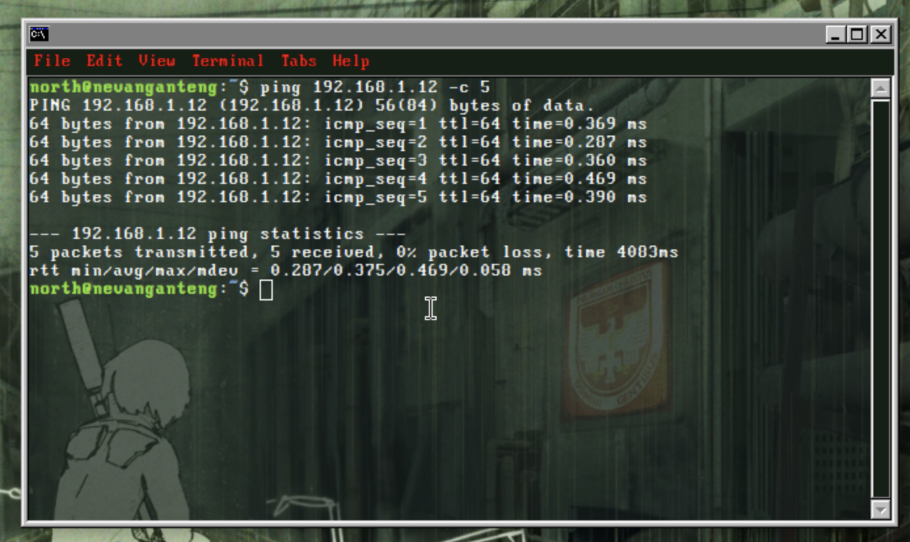
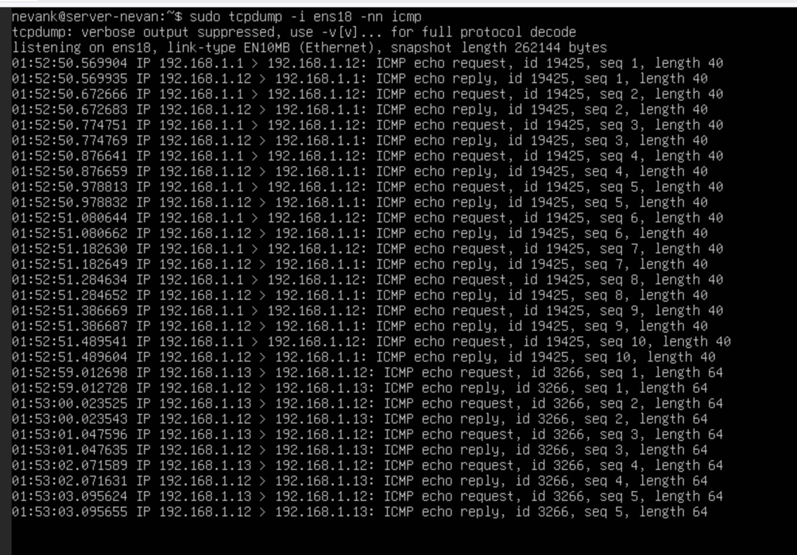
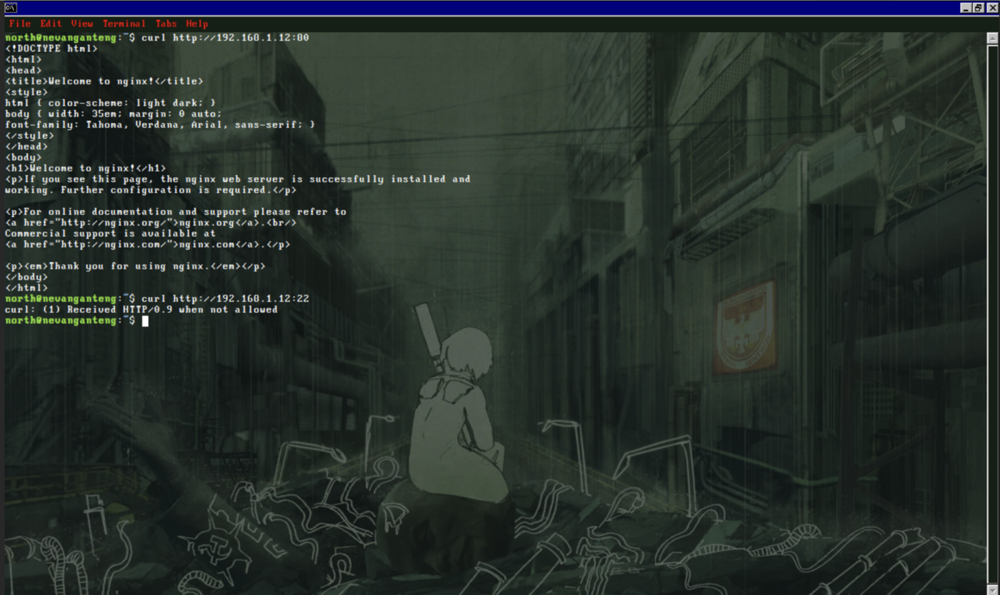
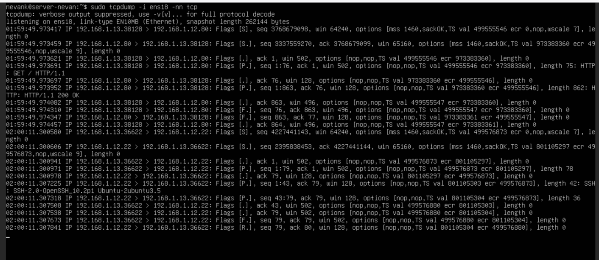
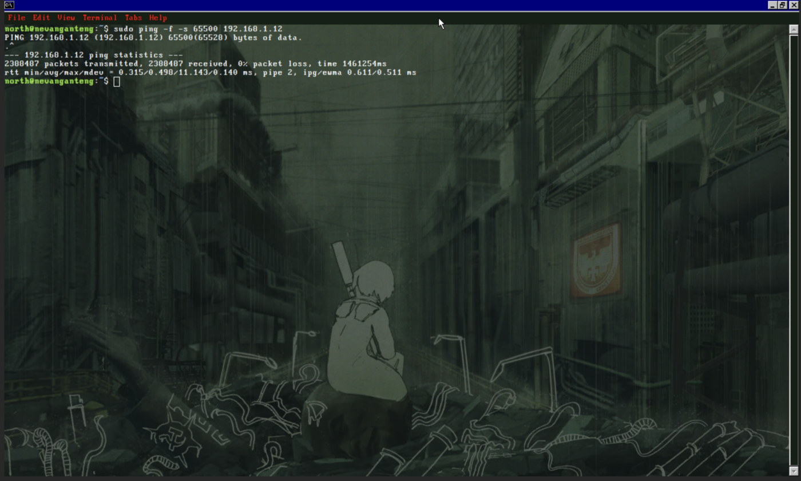
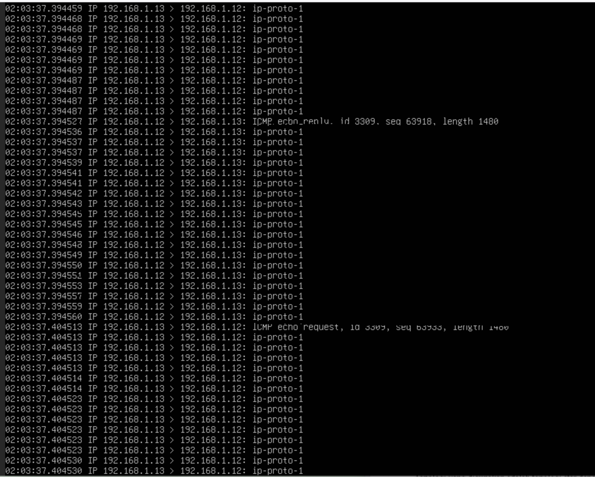
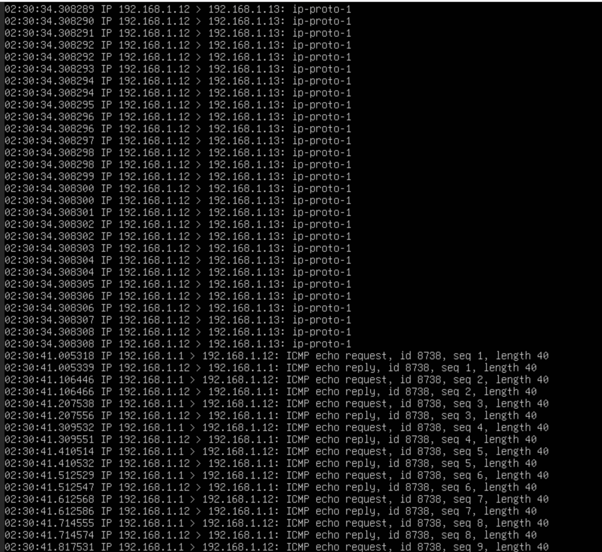
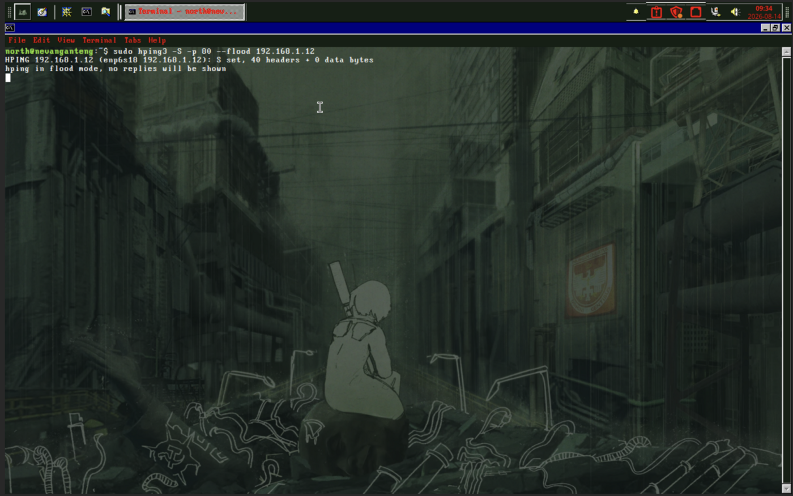
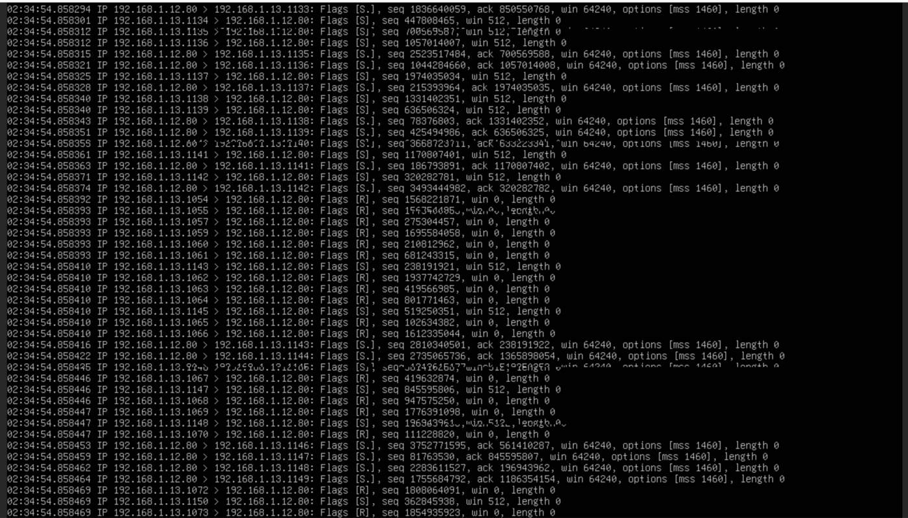
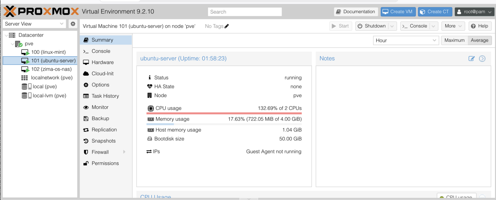

# Analisa Traffic Jaringan dengan tcpdump — Normal vs Anomali

Dokumentasi tugas analisa lalu lintas jaringan: membedakan traffic normal dari pola serangan (anomali) dengan memantau paket memakai **tcpdump** dari sisi server/Administrator.

- **Oleh:** Nevan Kaindra Rusdi — SMK Bina Informatika (TKJ)
- **Fokus:** Network monitoring & traffic analysis (Blue Team / defensif)
- **Tools:** `tcpdump`, `ping`, `curl`, `hping3`, Proxmox VE

> Topologi lab: Attacker `192.168.1.13`, Server `192.168.1.12`, Gateway `192.168.1.1`. Semua dikerjakan di lingkungan lab tertutup untuk belajar mengenali tanda-tanda serangan.

## Daftar Isi
1. [Traffic ICMP Normal](#1-traffic-icmp-normal)
2. [Traffic TCP — Akses Web Server & SSH](#2-traffic-tcp--akses-web-server--ssh)
3. [Anomali: ICMP Flood](#3-anomali-icmp-flood)
4. [Anomali: TCP SYN Flood](#4-anomali-tcp-syn-flood)
5. [Kesimpulan](#5-kesimpulan)

---

## 1. Traffic ICMP Normal

Dari sisi Attacker dilakukan ping standar ke server tanpa opsi tambahan yang mencurigakan.



Hasil capture `tcpdump` di sisi server menunjukkan pasangan **echo request/reply** yang rapi, baik dari gateway (`192.168.1.1`) maupun dari Attacker (`192.168.1.13`), dengan interval waktu antar paket yang konsisten.

```bash
sudo tcpdump -i ens18 -nn icmp
```



**Ciri normal:** jumlah paket wajar, request selalu berpasangan dengan reply, ukuran paket kecil (±40 byte), interval teratur.

---

## 2. Traffic TCP — Akses Web Server & SSH

Attacker mengakses layanan web di server menggunakan `curl`.



Log `tcpdump` di sisi server memperlihatkan siklus koneksi TCP yang lengkap dan wajar: **3-way handshake** (SYN → SYN-ACK → ACK), lalu tukar data (permintaan halaman web dibalas `200 OK`, dan server SSH mengirim info versinya), sampai akhirnya koneksi ditutup dengan rapi.



**Ciri normal:** handshake lengkap, koneksi dibuka dan ditutup dengan tertib, jumlah koneksi masuk akal.

---

## 3. Anomali: ICMP Flood

Attacker mengirimkan flood ICMP dengan ukuran paket jauh lebih besar dari normal (**65500 byte**) dan tanpa jeda antar paket (opsi `-f`).



Karena ukuran paketnya jauh lebih besar dari batas normal jaringan Ethernet, setiap satu ping otomatis dipecah menjadi puluhan **fragmen** oleh sistem. Di log `tcpdump`, pecahan ini muncul sebagai baris `ip-proto-1`.



Setelah serangan dihentikan, traffic kembali ke pola normal (ping rutin dari gateway dengan interval 100 ms, ukuran 40 byte), menegaskan kontras antara kondisi anomali dan kondisi normal.



**Ciri anomali:** paket berukuran sangat besar, banyak fragmen (`ip-proto-1`), jumlah paket per detik melonjak drastis.

---

## 4. Anomali: TCP SYN Flood

Sebagai variasi anomali lain, Attacker melancarkan **SYN flood** ke port HTTP (80) menggunakan `hping3` dalam mode flood, yang mengirim paket SYN secepat mungkin tanpa menunggu balasan.

```bash
sudo hping3 -S -p 80 --flood 192.168.1.12
```



Di log `tcpdump` server terlihat ciri khas SYN flood: ratusan paket SYN dikirim dari **port sumber yang berubah-ubah secara acak**, dalam waktu yang sangat berdekatan (hitungan mikrodetik). Server berusaha membalas satu per satu, tetapi banyak yang langsung dibalas RST. Bahkan ada baris log yang bertumpuk, tanda `tcpdump` kewalahan mencatat saking banyaknya paket.



Selama serangan berlangsung, beban CPU pada VM server (dipantau lewat Proxmox VE) melonjak tajam hingga di atas 100% dari kapasitas 2 vCPU — jauh di atas kondisi normal yang biasanya idle.



**Ciri anomali:** banjir paket SYN, port sumber acak, banyak koneksi tak pernah selesai, beban CPU server melonjak.

---

## 5. Kesimpulan

Dengan memantau pola traffic menggunakan `tcpdump`, seorang Administrator bisa membedakan mana pengunjung biasa dan mana yang sedang mencoba menyerang server, cukup dengan memperhatikan tanda-tanda seperti:

- Jumlah paket per detik yang tiba-tiba melonjak.
- Port sumber yang berubah-ubah secara acak.
- Banyaknya koneksi yang tidak pernah selesai (handshake tidak tuntas).
- Ukuran paket yang tidak wajar dan banyak fragmen.
- Lonjakan beban CPU/resource pada server.

Pemahaman pola ini adalah dasar untuk deteksi dini serangan dan langkah mitigasi seperti rate limiting, firewall rule, dan SYN cookies.

---

*Dokumentasi ini dibuat untuk pembelajaran. Seluruh pengujian dilakukan di lingkungan lab pribadi yang terisolasi.*
